# 🎃 Nuit Hantée — le bot Discord d'Halloween

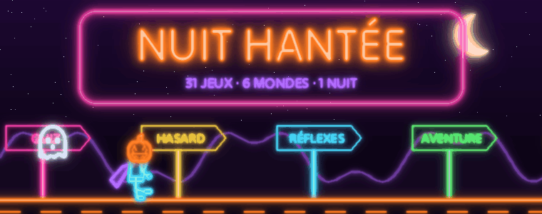

Un bot Halloween **entièrement refait**, avec sa propre identité visuelle : des
**enseignes au néon animées** qui grésillent sur un vieux mur de briques, un seul format
de panneau pour tous les jeux, **74 emojis personnalisés** (dont 21 animés) dessinés par
le bot lui-même, des images générées (carte de profil, podium, roue, course, cartes à
collectionner), **28 jeux** et **41 succès** à débloquer.

## ✨ Ce qui rend le bot unique

- **Un seul format de panneau** (Components V2) : bannière animée → titre → sections →
  boutons → pied de page. Chaque jeu a sa couleur, tout le bot a la même allure.
- **Scènes animées uniques** : chaque jeu a sa « ruelle hantée » sous la pluie : une
  enseigne néon dont les lettres grésillent une à une, son reflet dans les flaques, des
  éclairs sur le mur, un fantôme qui traverse la rue et des yeux qui clignent dans le noir.
  Le titre du panneau est au-dessus de la scène, pas dans un bandeau. Le même style habille la carte de profil, le podium,
  la roue et la course de balais.
- **Animé partout** : bannières GIF, emojis animés, comptes à rebours en direct,
  roue qui tourne réellement, course de sorcières animée, cartes qui se retournent,
  coffre et chaudron qui « s'ouvrent » et « bouillonnent ».
- **Emojis néon maison** : chaque emoji est une petite enseigne néon sur une tuile sombre
  (lisible en thème clair comme sombre), dessinée par le bot lui-même ; les animés grésillent.
- **Emojis personnalisés automatiques** : au démarrage, le bot dessine et envoie ses
  74 emojis dans *Developer Portal → ton application → Emojis*. Ils marchent dans
  **tous les serveurs**, sans Nitro et sans prendre de place sur le serveur.
  Ils sont mis à jour tout seuls si le dessin change.
- **Images générées** : carte de profil avec ton avatar, niveau et XP ; podium du
  classement avec les avatars du top 3.

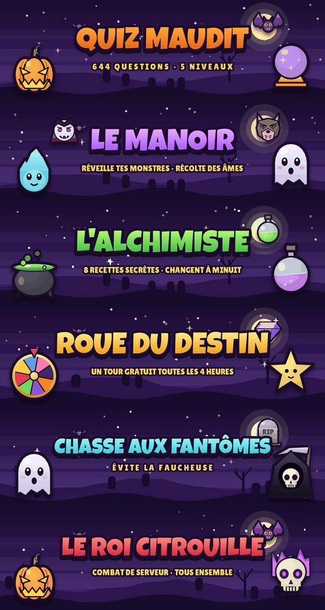

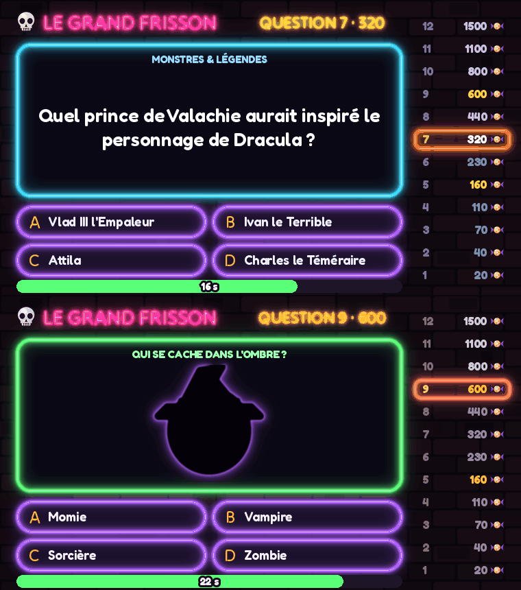

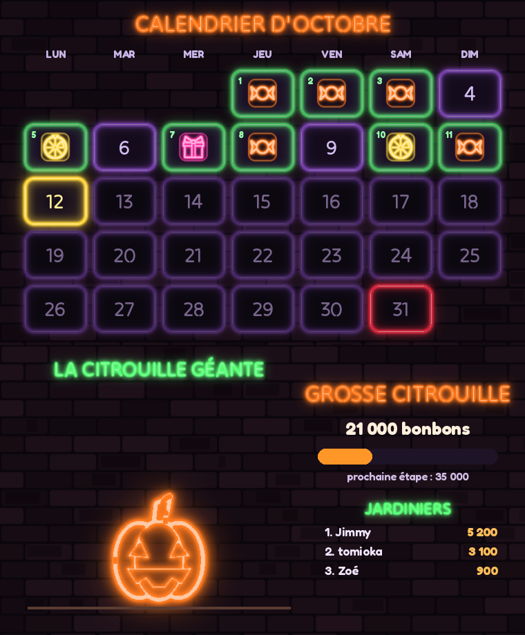

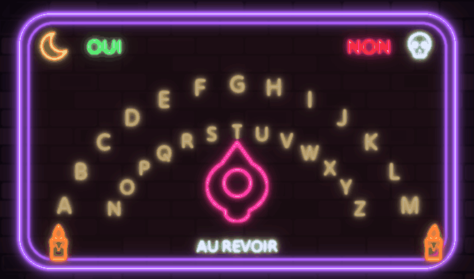

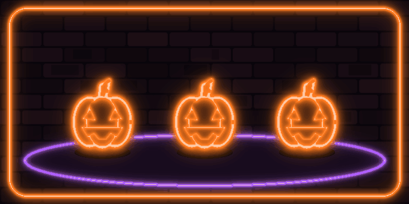

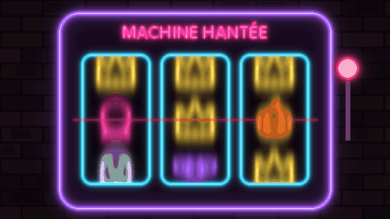

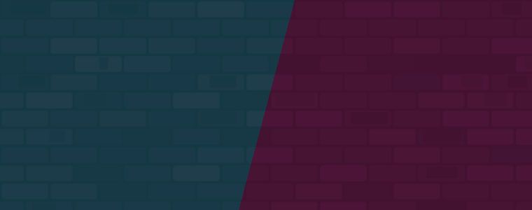

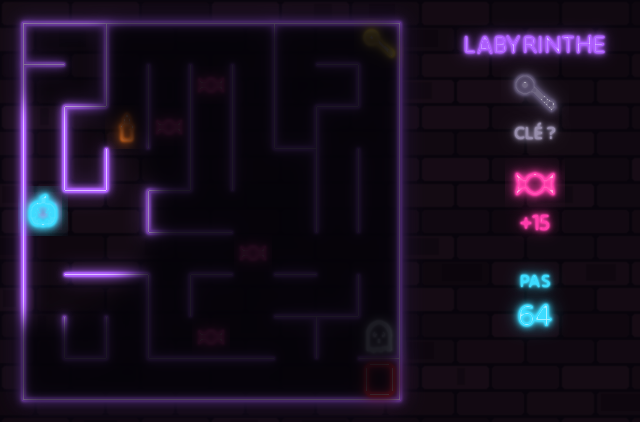

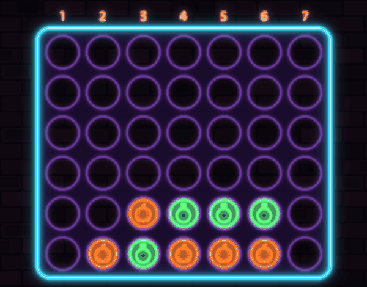

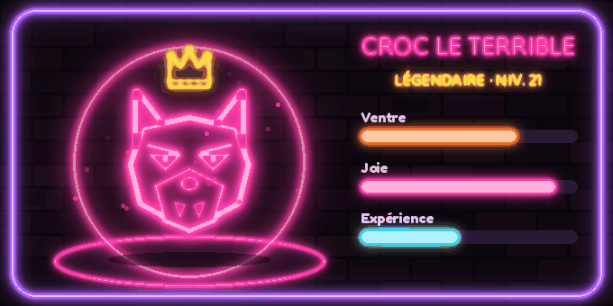

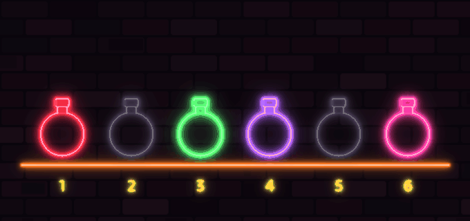

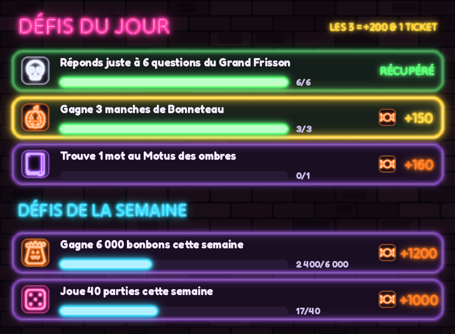

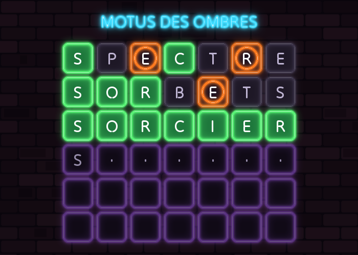

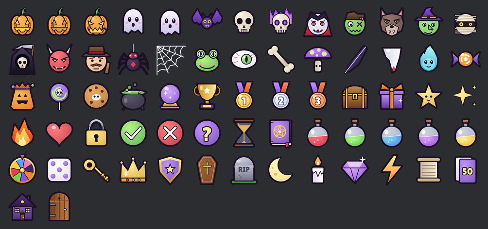

## 🕹️ Les jeux

| Commande | Jeu |
|---|---|
| `/jeux` | L'accueil : tous les jeux dans un menu, guide, coffre du jour |
| `/quiz` | **Le Grand Frisson**, le jeu télé hanté : 12 questions sur une **échelle de gains** jusqu'à 1 500 bonbons, 2 paliers, on peut encaisser à tout moment. Chaque question est une **vidéo GIF** (plateau néon, échelle, chrono qui se vide). 3 jokers : 50/50, **murmure du fantôme**, **vote du public**. Questions 3, 6 et 9 : **manche vidéo « Qui se cache dans l'ombre ? »** (une silhouette qui s'illumine). **700 questions** dont des questions de jeux vidéo |
| `/expedition` | **Expéditions** : envoie jusqu'à 3 de tes cartes de monstres en mission (30 min à 6 h). Plus ils sont rares, plus la mission réussit et plus le butin est gros |
| `/formule` | **La Formule** : déchiffre le code secret de 4 ingrédients du chaudron en 8 essais (façon Mastermind), la potion obtenue donne un effet bonus |
| `/roue` | **Roue du destin** animée, un tour gratuit toutes les 4 h, jackpot 1 000 |
| `/cartes` | **Cartes maudites** : 24 monstres à collectionner (4 raretés), révélation animée |
| `/maison` | **Maison hantée** : 4 pièces tirées au hasard parmi 10, 3 choix par pièce, trésors, pièges, monstres, 3 bougies de vie, une clé… et une **crypte** au trésor |
| `/course` | **Course de balais** : parie sur une des 4 sorcières, la course est un **GIF animé**, gain ×3,6 |
| `/rituel` | **Le Rituel** : mémorise la formule maudite qui s'efface, répète-la, elle s'allonge à chaque manche |
| `/ouija` | **La Planche Ouija** : une vidéo où l'esprit épelle un mot lettre par lettre (la 3ᵉ manche à l'envers !), retrouve-le parmi 4 |
| `/bonneteau` | **Le Bonneteau des Citrouilles** : un bonbon sous 3 citrouilles néon qui se mélangent en vidéo, de plus en plus vite. Suis-le ! |
| `/defi` | **Défi en direct** : face-à-face contre un membre dans un seul panneau, quiz éclair (le premier qui trouve marque) ou réflexes (faux départ = point pour l'autre), intro « VS » animée avec vos avatars, mise de bonbons |
| `/labyrinthe` | **Le Labyrinthe hanté** : brouillard néon, trouve la clé puis la porte, le fantôme te traque (la bougie sacrée le fait fuir) |
| `/puissance4` | **Puissance 4 maudit** : pions néon qui tombent en animation, contre la Sorcière (IA) ou contre un membre avec mise |
| `/familier` | **Familier hanté** : adopte un fantôme, une chauve-souris, une citrouille, une araignée ou un loup-garou animé. Nourris-le, joue avec lui, il te rapporte des bonbons et évolue jusqu'à la forme légendaire couronnée |
| `/roulette` | **Roulette des potions** : 6 fioles, une empoisonnée, chaque gorgée fait grimper le pot (jusqu'à ×4,5) |
| `/defis` | **Défis** : 3 défis du jour et 2 de la semaine, suivis automatiquement dans tous les jeux, avec bonus si tu fais les 3 |
| `/machine` | **La Machine hantée** : machine à sous néon, les rouleaux tournent et s'arrêtent un par un (jackpot ×150) |
| `/motus` | **Motus des ombres** : trouve le mot d'Halloween en 6 essais, les lettres se retournent en animation |
| `/plusoumoins` | **Plus ou Moins** : la carte suivante est-elle plus haute ou plus basse ? Encaisse avant de tout perdre |
| `/reflexe` | **Réflexe du fantôme** : clique dès que le bouton passe au vert, 3 manches chronométrées |
| `/memoire` | **Mémoire d'outre-tombe** : 8 paires sur une grille de 16 boutons |
| `/chasse` | **Chasse aux fantômes** : creuse des tombes, double ton butin… évite les 3 Faucheuses |
| `/pendu` | **Le Pendu de la crypte** : 50 mots d'Halloween, indice, proposition du mot entier |
| `/sort @membre` | **Mauvais sort** : vole jusqu'à 8 % des bonbons d'un rival (60 % de réussite, sinon le sort se retourne contre toi). L'**amulette** de la boutique protège |
| `/duel @membre [mise]` | **Duel de monstres** : Vampire / Loup-garou / Chasseur en 2 manches gagnantes, mise en bonbons sécurisée |
| `/calendrier` | **Calendrier d'octobre** en néon : une case par jour jusqu'à Halloween, la case 13 est maudite (666 bonbons… ou rien), le **31** cache le grand jackpot et une **carte légendaire** |
| `/citrouille` | **La Citrouille Géante** : tout le serveur la nourrit avec ses bonbons, elle grandit en 7 étapes et chaque étape récompense **tous les jardiniers** |
| `/quotidien` | **Coffre du jour** avec série de 7 jours (booster offert au 7e jour) |
| `/boutique` | Jokers, boucliers, tickets, potions, amulettes, **titres** et **couleurs de profil** |
| `/succes` | **41 succès** avec barres de progression, chacun rapporte un bonus de bonbons |
| `/profil [membre]` | Carte de chasseur générée en néon, parties restantes, contenu du sac, expédition en cours |
| `/classement` | **Le Panthéon** : bonbons, total gagné, niveau, bonnes réponses, record du Grand Frisson, expéditions, cartes, duels |
| `/donner` | Offrir des bonbons (2 000 max par jour) |
| `/aide` | Guide du joueur |

### 👻 Événements de serveur

Dans le salon choisi par les organisateurs, quand le serveur est actif :

- **Sac de bonbons** : le premier qui clique gagne.
- **Quiz éclair** : première bonne réponse gagne, une seule tentative par personne.
- **Le Roi Citrouille** : boss collectif ! Ses PV s'adaptent au nombre de joueurs
  actifs, tout le monde frappe ensemble, récompenses selon les dégâts.

### 🔧 Commandes d'organisation (`Gérer le serveur`)

| Commande | Rôle |
|---|---|
| `/admin salon` | Salon des apparitions |
| `/admin apparitions` | Activer/désactiver, fréquence (tous les N messages, max 1 toutes les 4 min) |
| `/admin lancer` | Lancer tout de suite un sac, un quiz éclair ou le boss |
| `/admin bonbons` | Ajouter / retirer des bonbons à un membre |
| `/admin emojis` | Re-synchroniser les emojis personnalisés |

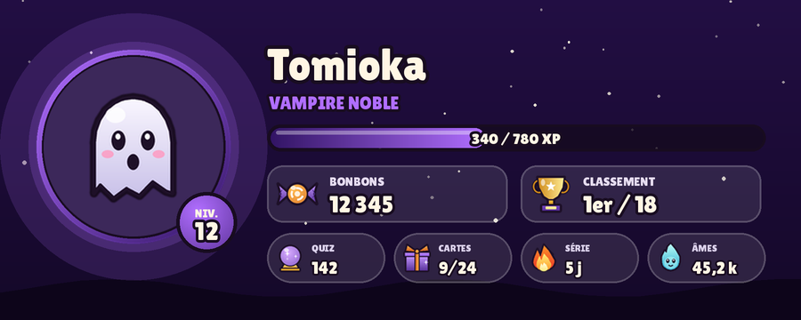

## 🚀 Installation

1. **Developer Portal** → ton application → *Bot* : copie le token.
   Aucun « Privileged Intent » n'est nécessaire.
2. Invite le bot avec les scopes `bot` et `applications.commands` et ces permissions :
   Voir les salons, Envoyer des messages, Intégrer des liens, Joindre des fichiers,
   Lire l'historique, Utiliser des emojis externes.
   Lien prêt à l'emploi (remplace `APP_ID`) :
   `https://discord.com/oauth2/authorize?client_id=APP_ID&scope=bot+applications.commands&permissions=379904`
3. Sur Railway (ou ailleurs) :
   - variable secrète **`discord_token`** (ou `DISCORD_TOKEN`) ;
   - un **volume** monté sur `/data` (sinon les bonbons sont effacés à chaque déploiement) ;
   - commande de démarrage : `python3 main.py` (déjà dans `railway.toml` et `Procfile`).
4. Au premier démarrage, le bot envoie ses emojis (environ 1 minute), puis tout
   s'affiche avec les emojis personnalisés. En attendant, des emojis classiques
   sont utilisés automatiquement.
5. Sur ton serveur : `/admin salon` pour activer les apparitions, puis `/jeux` !

Variables optionnelles : `DATA_DIR` (dossier de la base, `/data` par défaut s'il existe),
`DATABASE_PATH`, `BOT_TIMEZONE` (par défaut `Europe/Paris`, pour la remise à zéro de minuit).

> La nouvelle base s'appelle `nuit_hantee.sqlite3` : le classement repart à zéro
> avec ce nouveau bot. Chaque serveur a sa propre économie.

## 🧪 Tests

```sh
pip install -r requirements.txt
python -m compileall -q main.py halloween tests
python -m unittest discover -s tests -v
```

Les tests cliquent dans chaque jeu comme un joueur (sans connexion à Discord),
vérifient la base de données, la banque de questions, les images, et que chaque
panneau respecte les limites de Discord (40 composants, 4 000 caractères), même avec
les emojis personnalisés.

## 📂 Structure

```
main.py                     démarrage du bot
halloween/
  ui.py                     LE format de panneau unique + navigation persistante
  db.py                     SQLite (transactions, anti-solde négatif)
  emojis.py                 envoi et utilisation des emojis d'application
  config.py                 équilibrage : gains, limites, boutique, Grand Frisson, roue, succès
  rewards.py                bonbons + XP + passage de niveau
  art/                      dessin des emojis, bannières GIF, cartes et images
  content/                  questions du quiz, mots du pendu, potions, cartes
  cogs/                     un fichier par jeu
assets/fonts/               polices libres (OFL / Apache 2.0)
tests/
```

Le jeu utilise uniquement des bonbons virtuels : **aucun argent réel ni mise d'argent**.
Les polices Luckiest Guy (Apache 2.0), Lilita One, Fredoka et Tilt Neon (SIL OFL)
sont incluses avec leurs licences dans `assets/fonts/`.
